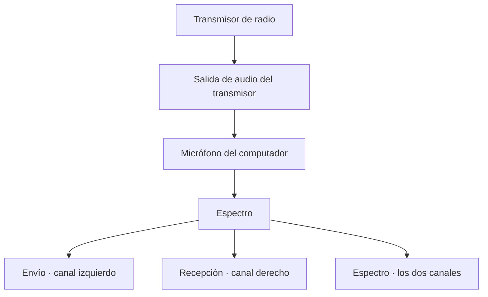
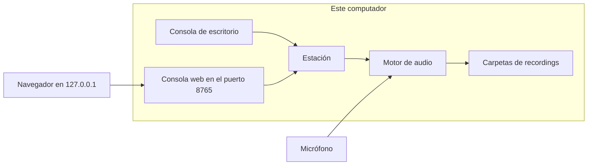
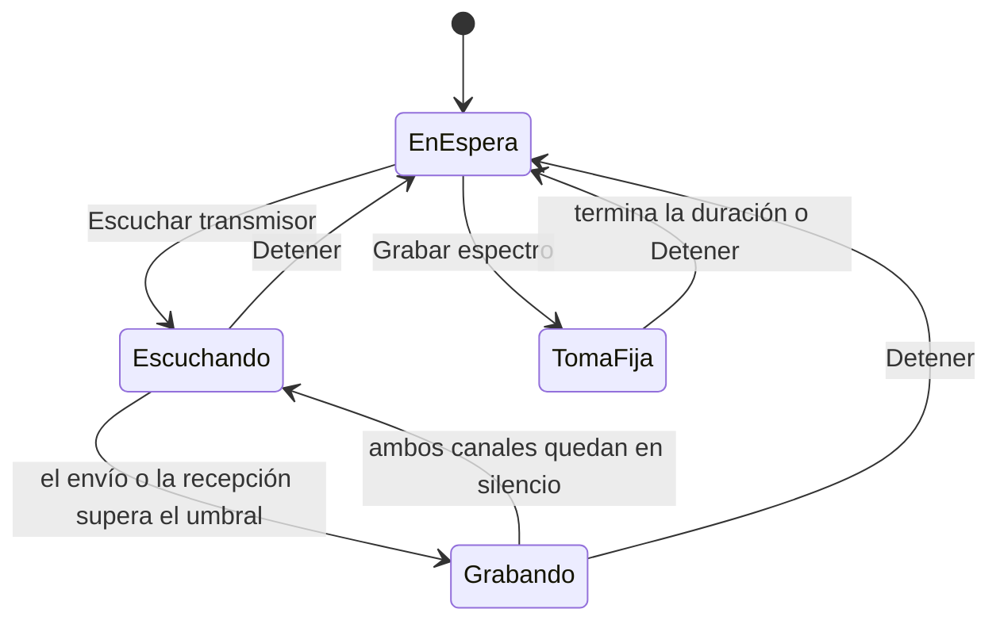

# Espectro

Espectro es un monitor de audio para radios: escucha el transmisor y guarda lo que se envió y lo que se recibió.

El micrófono del computador escucha la salida de un transmisor. Un mensaje de radio tiene dos lados: lo que la estación envía y lo que recibe de vuelta. Espectro guarda esos dos canales por separado y también el conjunto, para conservar el espectro completo del intercambio.

No es un analizador de radiofrecuencia. Trabaja sobre el audio que el transmisor ya reproduce, y lo hace entero en el equipo local.

## Ventajas

- **Los dos lados del mensaje quedan registrados.** Una grabación de un solo canal suele quedarse con la mezcla o con un solo interlocutor. Aquí el envío y la recepción se pueden escuchar juntos o cada uno por su cuenta.
- **No hay que pulsar grabar en cada transmisión.** En modo escucha, la toma empieza cuando el envío o la recepción superan el umbral y termina cuando ambos canales quedan en silencio. El operador sigue en el radio.
- **También existe la toma de duración fija.** Sirve para un ensayo, una prueba de nivel o un tramo que se quiere guardar sí o sí.
- **Se ve qué lado está hablando.** Los medidores de envío y recepción, y las bandas del espectro, muestran la actividad mientras ocurre.
- **Los archivos quedan ordenados solos.** Cada mes tiene su carpeta, y dentro van el espectro, el envío y la recepción con el mismo nombre.
- **Hay dos puestos para la misma estación.** La consola de escritorio está junto al micrófono. La consola web, en el navegador de ese mismo computador, sirve para revisar y reproducir sin ocupar la captura.
- **El audio no sale del equipo.** La web solo acepta conexiones de `127.0.0.1`. No hay cuenta en la nube ni envío de archivos.
- **Se instala igual en otro computador.** Un comando crea el entorno e instala las dependencias. No hay rutas de una máquina concreta dentro del programa.

## Cómo viaja el audio



El canal izquierdo es el envío: lo que sale de la estación. El canal derecho es la recepción: lo que vuelve. Los dos juntos son el espectro del mensaje. Si el micrófono solo tiene un canal, la toma se guarda igual, en `Mono/`, y el programa avisa de que falta un lado.

## Las dos consolas



Las dos consolas comparten el micrófono, el umbral y la lista de mensajes. Si `python main.py` está abierto, la web nace con él. Si solo se quiere el navegador, se usa el módulo web, descrito más abajo.

## Ciclo de escucha



El silencio que cierra una toma es el valor **Silencio (s)**. Mientras cualquiera de los dos canales siga por encima del umbral, ese plazo se renueva. Una toma continua se corta a los 10 minutos para no llenar el disco si el umbral quedó demasiado bajo. Al detener, se guarda lo que ya se alcanzó a oír.

La escala del umbral es la del nivel RMS del audio: el silencio está en 0 y un tono fuerte ronda 700. El valor 20 es un punto de partida. Si arrancan tomas con el ruido de la sala, súbelo. Si el transmisor habla y no graba, bájalo.

## Instalación

Hace falta Python 3.11 o 3.12 y un micrófono, mejor si es estéreo y está frente a la salida del transmisor. El proyecto no trae instalador de Python: cualquier persona lo instala desde [python.org](https://www.python.org/downloads/) y marca, en Windows, la opción de agregarlo al PATH.

Clona el repositorio, entra en la carpeta y ejecuta:

```bash
python install.py
```

Eso crea `.venv` en esta carpeta e instala PyAudio, NumPy y Flask ahí. El resto del sistema no se modifica. Para abrir la estación, usa el Python de ese entorno, no el Python global.

Windows:

```bash
.venv\Scripts\python main.py
```

macOS y Linux:

```bash
.venv/bin/python main.py
```

Solo la consola web, sin la ventana de escritorio:

```bash
.venv\Scripts\python -m pyaudio_app.web
```

```bash
.venv/bin/python -m pyaudio_app.web
```

Queda en `http://127.0.0.1:8765`.

### Si PyAudio no instala

En Windows, Python 3.11 y 3.12 reciben una rueda lista. No hace falta compilar.

En macOS, si pip no encuentra la biblioteca:

```bash
brew install portaudio
python install.py
```

En Debian o Ubuntu:

```bash
sudo apt install portaudio19-dev python3-dev
python install.py
```

En Fedora:

```bash
sudo dnf install portaudio-devel python3-devel
python install.py
```

La carpeta del proyecto se puede mover o copiar a otro equipo. Hay que volver a ejecutar `python install.py` allí, porque `.venv` no se comparte entre sistemas. Las grabaciones y la base de usuarios, si se copian junto con el proyecto, siguen en `recordings/` y `data/`.

## Uso

La primera vez, en las dos consolas, el acceso es el usuario local `Admin` con la contraseña `Admin1234`. Esa cuenta se crea en el equipo al abrir el programa. La contraseña se guarda hasheada en `data/usuarios.db`. No viaja en el repositorio.

1. Elige el micrófono que apunta al transmisor.
2. Deja duración, umbral y silencio, o ajústalos.
3. **Escuchar transmisor** vigila el audio y guarda cada mensaje.
4. **Grabar espectro** toma los segundos indicados, sin esperar el umbral.
5. **Detener** corta la captura.
6. En la lista, **Espectro** reproduce el mensaje completo, **Envío** solo el canal izquierdo y **Recepción** solo el derecho.

En la consola web cada canal tiene su reproductor. **Consola web**, en la ventana de escritorio, abre el navegador. Las dos piden el mismo usuario porque son la misma estación.

### Carpetas de cada mes

```text
recordings/2026-09/
  Espectro/      mensaje completo, estéreo
  Envio/         canal izquierdo
  Recepcion/     canal derecho
  Mono/          solo si la entrada no tiene dos canales
```

El nombre del archivo es la fecha y la hora de la toma, por ejemplo `2026-09-29_12-25-00.wav`. Si en el mismo segundo se guarda otra, se agrega un sufijo.

## Qué hay en el programa

| Pieza | Rol |
| --- | --- |
| `install.py` | Crea `.venv` e instala las dependencias en cualquier sistema con Python 3.11+. |
| `main.py` | Abre la consola de escritorio y, en el mismo proceso, la consola web. |
| `pyaudio_app/ui.py` | Ventana: acceso, medidores, espectro y lista de mensajes. |
| `pyaudio_app/web.py` | Sitio local: las mismas acciones y los reproductores. |
| `pyaudio_app/station.py` | Estado único que comparten las dos consolas. |
| `pyaudio_app/engine.py` | Abre el micrófono, aplica el umbral y reproduce por los altavoces. |
| `pyaudio_app/wavutil.py` | Nivel de cada canal, bandas del espectro y separación del WAV. |
| `pyaudio_app/storage.py` | Escribe las carpetas del mes y arma la lista de tomas. |
| `pyaudio_app/auth.py` | Usuarios locales. La contraseña no se guarda en texto plano. |
| `pyaudio_app/brand.py` | Nombre del producto y título de la ventana. |
| `legacy/` | Referencia de la versión inicial. No es el programa que se ejecuta. |

La consola web pide una clave de sesión la primera vez y la escribe en `data/web_secret`. Ese archivo es de este equipo. No forma parte del código.

## Qué no se versiona

El repositorio no lleva audios, la base de usuarios, la clave de sesión ni el entorno virtual. `.gitignore` deja fuera `recordings/`, `data/`, `.venv/` y los archivos `.wav`, `.db` y `.env`.

No hay tokens ni credenciales de servicios externos. El único acceso que existe es el usuario local de fábrica, distinto en cada instalación porque el hash se genera al crear la base.

La consola web escucha únicamente en `127.0.0.1`. No la publiques hacia la red: está pensada para quien está sentado en ese computador.

## Pruebas

Con el entorno ya instalado:

```bash
.venv\Scripts\python -m unittest discover -s tests -v
```

```bash
.venv/bin/python -m unittest discover -s tests -v
```

Las pruebas cubren el nivel de cada canal, la separación del estéreo, las carpetas de la toma, el rechazo de una contraseña incorrecta y que la consola web no entregue archivos fuera de `recordings/`. No hace falta un micrófono para ejecutarlas.
